

<a href="https://bertmarti.github.io/BertMarti/">
  <picture>
    <source media="(prefers-color-scheme: dark)" srcset="./img/banner-dark.svg">
    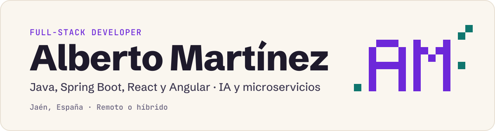
  </picture>
</a>

<!-- titular:inicio · generado por scripts/generar-tarjetas.mjs desde perfil.json: no lo edites a mano -->

### Full-Stack Developer · Java, Spring Boot, React y Angular · IA y microservicios

<!-- titular:fin -->

Desarrollador Full-Stack con más de 3 años en NTT DATA construyendo software para banca: microservicios con Spring Boot, procesos batch e interfaces en React y Angular. Especializado en modernizar arquitecturas con IA.

  
  
  

## Sobre mí

<!-- sobre:inicio · generado por scripts/generar-tarjetas.mjs desde perfil.json: no lo edites a mano -->

Desarrollador Full-Stack con más de 3 años en NTT DATA en proyectos empresariales de banca: microservicios, procesos batch y migración de arquitecturas. En backend trabajo con Java, Spring Boot y Spring Batch; en frontend, con React, Angular y TypeScript. Aplico IA y orquestación de agentes en proyectos reales de modernización. Mi formación en diseño gráfico me lleva a cuidar la interfaz tanto como el código.

### Experiencia · NTT DATA Europe &amp; Latam

<table>
  <tr>
    <td width="170" valign="top"><code>jul 2026 – hoy</code></td>
    <td valign="top"><strong>Rising Software Engineer</strong> Desarrollo Full-Stack en proyectos empresariales críticos con Java y Spring.</td>
  </tr>
  <tr>
    <td width="170" valign="top"><code>dic 2024 – hoy</code></td>
    <td valign="top"><strong>Full-Stack Developer (Java + Front) · Arquitectura</strong> Equipo multidisciplinar de arquitectura de una plataforma bancaria.</td>
  </tr>
  <tr>
    <td width="170" valign="top"><code>jun 2023 – dic 2024</code></td>
    <td valign="top"><strong>Junior Full-Stack / Frontend Developer</strong> Desarrollo de APIs REST y de las pantallas que las consumen.</td>
  </tr>
  <tr>
    <td width="170" valign="top"><code>mar 2023 – jun 2023</code></td>
    <td valign="top"><strong>Becario de desarrollo de software Full-Stack</strong> APIs REST con Spring e interfaces con Angular y JavaScript.</td>
  </tr>
</table>

### Formación

- **CFGS Desarrollo de Aplicaciones Web (DAW)** · IES Jándula, Andújar (Jaén) · 2021–2023 · Nota media: 9,5
- **Grado Profesional en Diseño Gráfico** · Escuela de Arte de Granada · 2017–2019

<!-- sobre:fin -->

## Tecnologías

<!-- tecnologias:inicio · generado por scripts/generar-tarjetas.mjs desde perfil.json: no lo edites a mano -->

<table>
  <tr>
    <td width="150"><strong>Backend</strong></td>
    <td>
      
      
      
      
      
      
      
    </td>
  </tr>
  <tr>
    <td width="150"><strong>Frontend</strong></td>
    <td>
      
      
      
      
      
      
      
    </td>
  </tr>
  <tr>
    <td width="150"><strong>Desarrollo asistido por IA</strong></td>
    <td>
      
      
      
      
    </td>
  </tr>
  <tr>
    <td width="150"><strong>Datos</strong></td>
    <td>
      
      
      
    </td>
  </tr>
  <tr>
    <td width="150"><strong>DevOps y calidad</strong></td>
    <td>
      
      
      
      
      
      
      
    </td>
  </tr>
  <tr>
    <td width="150"><strong>Otros</strong></td>
    <td>
      
      
      
      
      
      
    </td>
  </tr>
</table>

<!-- tecnologias:fin -->

## Proyectos personales

Aplicaciones completas que diseño, desarrollo y publico de principio a fin: arquitectura, UX, seguridad y despliegue. Pulsa una captura para abrir su web o su demo. Fresquito y Gestorín tienen el código privado; el resto es de código abierto.

<!-- destacados:inicio · generado por scripts/generar-tarjetas.mjs desde proyectos.json y perfil.json: no lo edites a mano -->

<table>
  <tr>
    <td width="50%" valign="top">
      <a href="https://fresquito-demo.pages.dev/">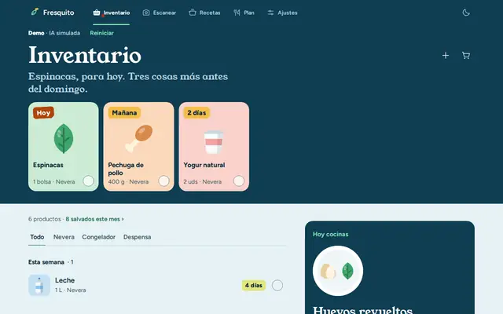</a>
      <h3><a href="https://github.com/BertMarti/fresquito-demo">Fresquito</a></h3>
      
<strong>Lo que hay en tu nevera, antes de que caduque.</strong> Inventario de nevera y despensa con IA: a partir de una foto o del ticket de compra registra los alimentos, avisa de las caducidades y propone recetas según las preferencias del usuario; lo que falta pasa a la lista de la compra. Web (PWA) y Android, con modelos de IA gratuitos por defecto.

      
<code>React</code> <code>TypeScript</code> <code>PWA</code> <code>Android (Capacitor)</code> <code>IA</code>

      
      
    </td>
    <td width="50%" valign="top">
      <a href="https://bertmarti.github.io/gestorin-demo/">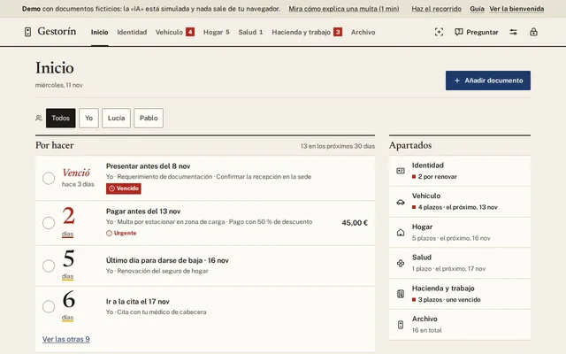</a>
      <h3><a href="https://github.com/BertMarti/gestorin-demo">Gestorín</a></h3>
      
<strong>Tu gestor de bolsillo.</strong> Asistente para el papeleo doméstico: explica cartas, multas y notificaciones oficiales en lenguaje claro, convierte cada plazo en una tarea y avisa con antelación. Para toda la familia, con IA local (Ollama) o sin IA; Windows y Android.

      
<code>Tauri</code> <code>Rust</code> <code>React</code> <code>TypeScript</code> <code>Ollama</code>

      
      
    </td>
  </tr>
  <tr>
    <td width="50%" valign="top">
      <a href="https://bertmarti.github.io/lazo/">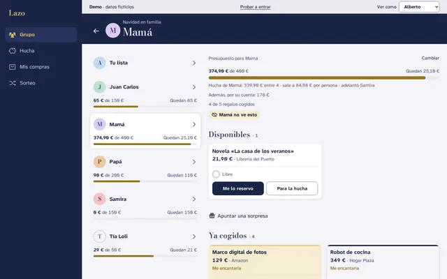</a>
      <h3><a href="https://github.com/BertMarti/lazo">Lazo</a></h3>
      
<strong>Listas de regalos en familia, sin repetidos ni spoilers.</strong> Aplicación de listas de regalos para familias y grupos: cada persona publica lo que quiere y el resto lo reserva o lo compra sin que el destinatario pueda verlo. Incluye fondo común, regalos compartidos y amigo invisible; web (PWA) y Android, autoalojada con PocketBase y auditada.

      
<code>React</code> <code>TypeScript</code> <code>PWA</code> <code>Android (Capacitor)</code> <code>PocketBase</code> <code>IA</code>

      
      
      
    </td>
    <td width="50%" valign="top">
      <a href="https://bertmarti.github.io/modelduel/">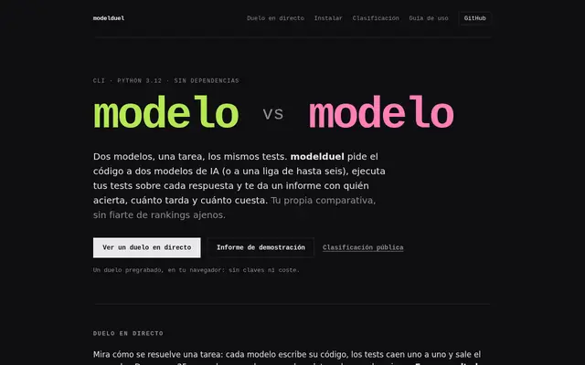</a>
      <h3><a href="https://github.com/BertMarti/modelduel">modelduel</a></h3>
      
<strong>Comparar modelos con datos, no con opiniones.</strong> Herramienta de línea de comandos que compara dos modelos de IA con la misma tarea y los mismos tests, y resume aciertos, tiempo y coste en un único informe. Admite tareas en Python, JavaScript o TypeScript y puede aislar el código generado en un contenedor.

      
<code>Python</code> <code>CLI</code> <code>pytest</code> <code>Docker</code>

      
      
    </td>
  </tr>
  <tr>
    <td width="50%" valign="top">
      <a href="https://bertmarti.github.io/commitling/">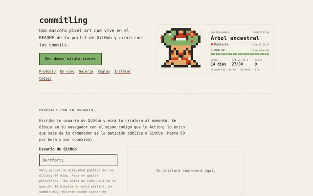</a>
      <h3><a href="https://github.com/BertMarti/commitling">commitling</a></h3>
      
<strong>Tu actividad convertida en una criatura digital.</strong> Mascota pixel-art para el perfil de GitHub que crece con la actividad de commits. Se genera como SVG animado con GitHub Actions y se instala con binarios verificables.

      
<code>Go</code> <code>GitHub Actions</code> <code>SVG animado</code> <code>WebAssembly</code>

      
      
    </td>
    <td width="50%" valign="top">
      <a href="https://bertmarti.github.io/printquote/">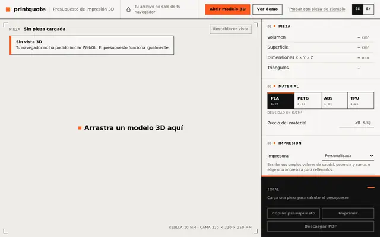</a>
      <h3><a href="https://github.com/BertMarti/printquote">printquote</a></h3>
      
<strong>Del modelo 3D al presupuesto en segundos.</strong> Calcula el peso, el tiempo de impresión y el precio de un modelo 3D (STL, OBJ o 3MF) directamente en el navegador, sin subir el archivo a ningún servidor. Genera el presupuesto en PDF, numerado y con los datos del encargo y del cliente.

      
<code>TypeScript</code> <code>Three.js</code> <code>Vite</code> <code>PWA</code>

      
      
    </td>
  </tr>
</table>

<!-- destacados:fin -->

## Más proyectos

Todos gratuitos y de código abierto; la mayoría puede probarse en el navegador. El [portafolio](https://bertmarti.github.io/BertMarti/) los recoge con más detalle.

<!-- tarjetas:inicio · generado por scripts/generar-tarjetas.mjs desde proyectos.json: no lo edites a mano -->

<table>
  <tr>
    <td width="33%" valign="top">
      <a href="https://bertmarti.github.io/ARIA/">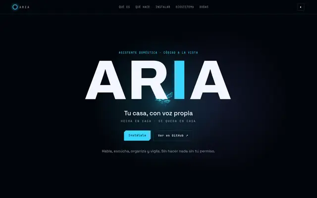</a>
      
<strong>🤖 <a href="https://github.com/BertMarti/ARIA">ARIA</a></strong> Tu casa, con voz propia. Python · FastAPI · Ollama · Docker · Telegram

      
<a href="https://bertmarti.github.io/ARIA/">Web</a> · <a href="https://github.com/BertMarti/ARIA">Código</a>

    </td>
    <td width="33%" valign="top">
      <a href="https://bertmarti.github.io/SHIELD-DNS/">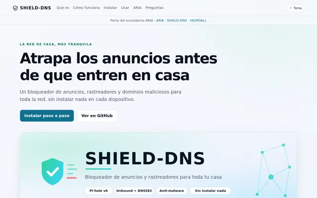</a>
      
<strong>🛡️ <a href="https://github.com/BertMarti/SHIELD-DNS">SHIELD-DNS</a></strong> Bloqueo de anuncios para toda la red doméstica. Pi-hole · Unbound · DNSSEC · Docker

      
<a href="https://bertmarti.github.io/SHIELD-DNS/">Web</a> · <a href="https://github.com/BertMarti/SHIELD-DNS">Código</a>

    </td>
    <td width="33%" valign="top">
      <a href="https://bertmarti.github.io/HEIMDALL/">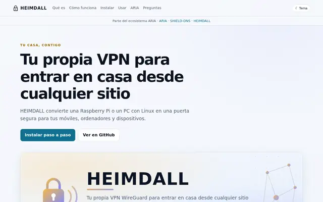</a>
      
<strong>🔐 <a href="https://github.com/BertMarti/HEIMDALL">HEIMDALL</a></strong> Acceso seguro a tu red doméstica desde cualquier lugar. WireGuard · wg-easy · Caddy · Docker

      
<a href="https://bertmarti.github.io/HEIMDALL/">Web</a> · <a href="https://github.com/BertMarti/HEIMDALL">Código</a>

    </td>
  </tr>
  <tr>
    <td width="33%" valign="top">
      <a href="https://bertmarti.github.io/repartito/">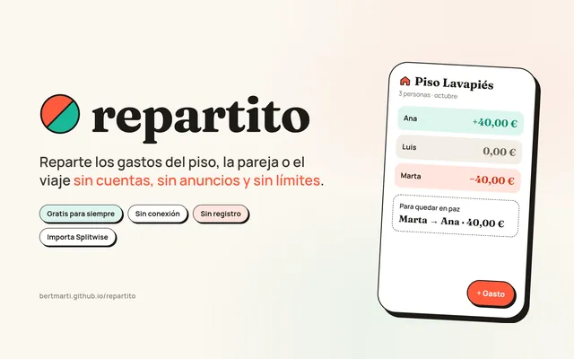</a>
      
<strong>🍫 <a href="https://github.com/BertMarti/repartito">Repartito</a></strong> Cuentas claras y el chocolate espeso. React · TypeScript · PWA · Android (Capacitor) · Web Crypto

      
<a href="https://bertmarti.github.io/repartito/">Web</a> · <a href="https://github.com/BertMarti/repartito/releases/latest">Android</a> · <a href="https://github.com/BertMarti/repartito">Código</a>

    </td>
    <td width="33%" valign="top">
      <a href="https://github.com/BertMarti/runa">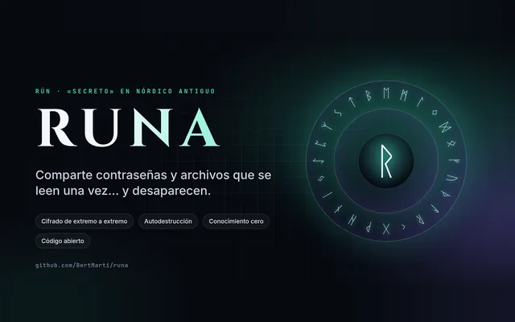</a>
      
<strong>🔥 <a href="https://github.com/BertMarti/runa">RUNA</a></strong> Secretos cifrados que se leen una sola vez. Fastify · React · Web Crypto · Docker · SQLite · Go

      
<a href="https://github.com/BertMarti/runa">Código</a> · Se instala en tu servidor

    </td>
    <td width="33%" valign="top">
      <a href="https://github.com/BertMarti/vitaclip/releases/latest">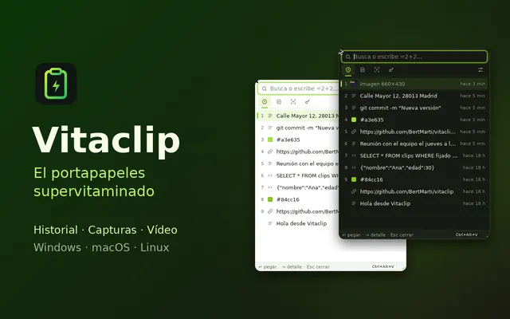</a>
      
<strong>🍋 <a href="https://github.com/BertMarti/vitaclip">Vitaclip</a></strong> El portapapeles supervitaminado. Tauri · Rust · JavaScript · Windows · macOS · Linux

      
<a href="https://github.com/BertMarti/vitaclip/releases/latest">Descargar</a> · <a href="https://github.com/BertMarti/vitaclip">Código</a>

    </td>
  </tr>
  <tr>
    <td width="33%" valign="top">
      <a href="https://bertmarti.github.io/Roscodex/">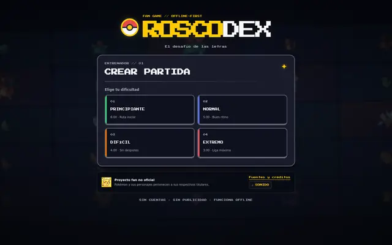</a>
      
<strong>🧭 <a href="https://github.com/BertMarti/Roscodex">Roscodex</a></strong> El rosco de las letras, versión Pokémon. React · TypeScript · Vite · PWA

      
<a href="https://bertmarti.github.io/Roscodex/">Jugar</a> · <a href="https://github.com/BertMarti/Roscodex">Código</a>

    </td>
    <td width="33%" valign="top">
      <a href="https://bertmarti.github.io/Adivina-pkm/">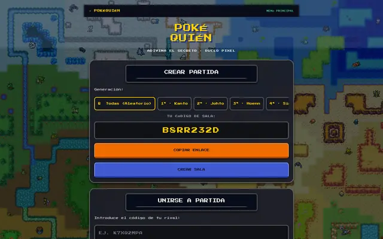</a>
      
<strong>🎮 <a href="https://github.com/BertMarti/Adivina-pkm">PokéQuién</a></strong> ¿Quién es quién?, con Pokémon. React Native (Expo) · TypeScript · WebSocket

      
<a href="https://bertmarti.github.io/Adivina-pkm/">Jugar</a> · <a href="https://github.com/BertMarti/Adivina-pkm">Código</a>

    </td>
    <td width="33%" valign="top">
      <a href="https://bertmarti.github.io/squad-summoner-v3/">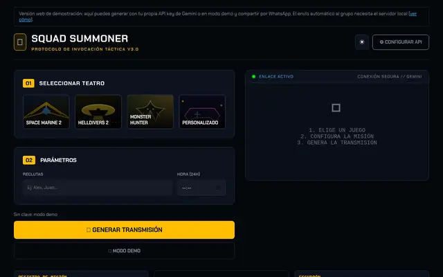</a>
      
<strong>🎖️ <a href="https://github.com/BertMarti/squad-summoner-v3">Squad Summoner</a></strong> Convocatorias épicas para tu escuadrón. Vue 3 · TypeScript · Vite · Gemini

      
<a href="https://bertmarti.github.io/squad-summoner-v3/">Web</a> · <a href="https://github.com/BertMarti/squad-summoner-v3">Código</a>

    </td>
  </tr>
</table>

<!-- tarjetas:fin -->

## Hablemos

¿Tienes una idea, un proyecto interesante o ganas de intercambiar aprendizajes sobre frontend, backend o IA? Puedes escribirme en [LinkedIn](https://www.linkedin.com/in/alberto-martinez-moreno/) o por [email](mailto:amarmor878@gmail.com).

<a href="https://bertmarti.github.io/commitling/">
  <picture>
    <source media="(prefers-color-scheme: dark)" srcset="./commitling-dark.svg">
    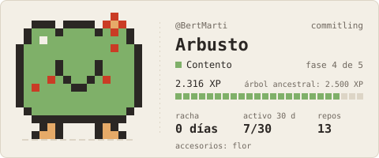
  </picture>
</a>

Mi <a href="https://github.com/BertMarti/commitling">commitling</a> crece con mis commits y se actualiza cada día.

