

<a href="https://bertmarti.github.io/BertMarti/">
  <picture>
    <source media="(prefers-color-scheme: dark)" srcset="./img/banner-dark.svg">
    
  </picture>
</a>

# 👋 Hola, soy Alberto Martínez

### Senior Full-Stack Developer · NTT DATA · Frontend + Backend + IA

Construyo productos digitales de principio a fin: desde una interfaz clara y rápida hasta APIs robustas, procesos batch y automatizaciones que aguantan el mundo real.

  
  
  

## 🚀 Sobre mí

Soy desarrollador de software **senior** con más de **3 años de experiencia en el sector**, actualmente trabajando en **NTT DATA**. Me muevo con naturalidad entre el frontend y el backend: me interesa tanto que una aplicación se sienta bien como que su arquitectura sea mantenible, observable y preparada para crecer.

Mi día a día combina **React, Angular, TypeScript, Java, Spring Boot y Spring Batch**, trabajando en equipos ágiles y en contextos donde la calidad del código, la entrega continua y la colaboración importan tanto como la solución final.

> **Mi forma de trabajar:** entender el problema, simplificarlo y convertirlo en software útil. El buen diseño es tan importante como el buen código.

## 🌟 Proyectos públicos

Todos son gratuitos y de código abierto, y casi todos se prueban en el navegador. Pulsa la imagen para abrir su web (o la descarga, o el código si se instala en tu propio servidor).

<!-- tarjetas:inicio · generado por scripts/generar-tarjetas.mjs desde proyectos.json: no lo edites a mano -->

### 🏠 Para tu casa

<table>
  <tr>
    <td width="33%" valign="top">
      <a href="https://bertmarti.github.io/ARIA/">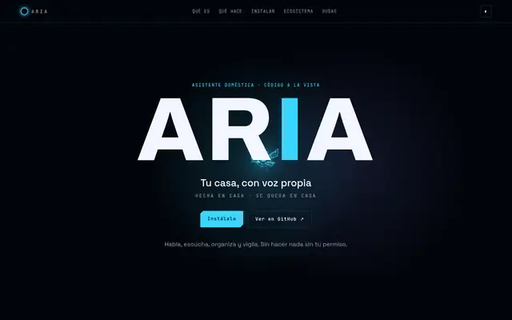</a>
      <h3>🤖 <a href="https://github.com/BertMarti/ARIA">ARIA</a></h3>
      
<strong>Tu casa, con voz propia.</strong> Asistente de IA autoalojado que gestiona las apps de tu casa: chat y voz, Telegram, rutinas y control parental. Gratis, en una Raspberry Pi o un PC.

      
Python · FastAPI · Ollama · Docker · Telegram

      
      
    </td>
    <td width="33%" valign="top">
      <a href="https://bertmarti.github.io/SHIELD-DNS/">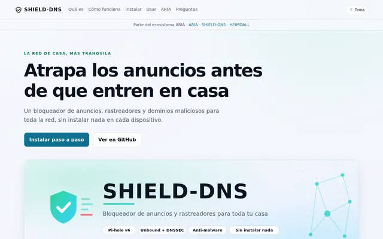</a>
      <h3>🛡️ <a href="https://github.com/BertMarti/SHIELD-DNS">SHIELD-DNS</a></h3>
      
<strong>Adiós a los anuncios en toda la casa.</strong> Bloquea anuncios y rastreadores en todos tus dispositivos a la vez (Pi-hole + Unbound con DNSSEC), con guía paso a paso.

      
Pi-hole · Unbound · DNSSEC · Docker

      
      
    </td>
    <td width="33%" valign="top">
      <a href="https://bertmarti.github.io/HEIMDALL/">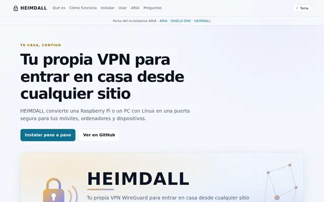</a>
      <h3>🔐 <a href="https://github.com/BertMarti/HEIMDALL">HEIMDALL</a></h3>
      
<strong>Tu casa, a mano desde cualquier sitio.</strong> Tu propia VPN WireGuard para entrar en casa desde fuera de forma segura, con guía paso a paso.

      
WireGuard · wg-easy · Caddy · Docker

      
      
    </td>
  </tr>
</table>

### 🧾 Para tu día a día

<table>
  <tr>
    <td width="50%" valign="top">
      <a href="https://bertmarti.github.io/repartito/">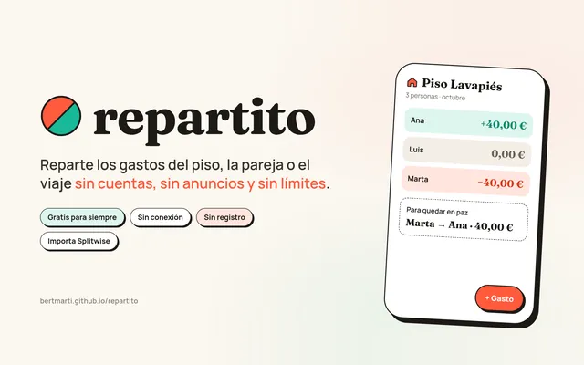</a>
      <h3>🍫 <a href="https://github.com/BertMarti/repartito">Repartito</a></h3>
      
<strong>Cuentas claras y el chocolate espeso.</strong> Reparte los gastos del piso, la pareja o el viaje: gratis, sin cuentas ni anuncios y sin conexión. Plantillas, recordatorios y fotos de tickets que nunca salen del móvil. Web (PWA) y Android, cifrado y auditado.

      
React · TypeScript · PWA · Android (Capacitor) · Web Crypto

      
      
      
    </td>
    <td width="50%" valign="top">
      <a href="https://github.com/BertMarti/runa">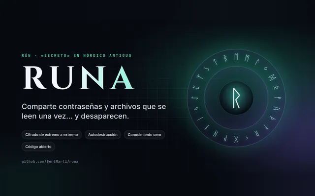</a>
      <h3>🔥 <a href="https://github.com/BertMarti/runa">RUNA</a></h3>
      
<strong>Secretos que se leen una vez… y desaparecen.</strong> Comparte contraseñas y archivos cifrados de extremo a extremo que se autodestruyen al leerse, o pide un secreto con un enlace: llega cifrado solo para ti. Autoalojable con Docker, conocimiento cero, auditado.

      
Fastify · React · Web Crypto · Docker · SQLite

      
      
    </td>
  </tr>
</table>

### 🛠️ Herramientas e IA

<table>
  <tr>
    <td width="33%" valign="top">
      <a href="https://bertmarti.github.io/modelduel/">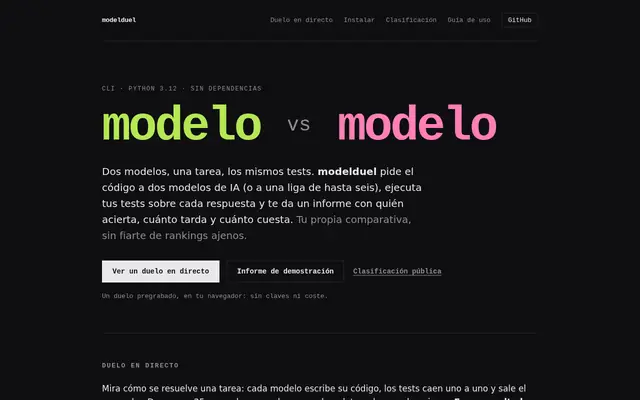</a>
      <h3>⚔️ <a href="https://github.com/BertMarti/modelduel">modelduel</a></h3>
      
<strong>Comparar modelos con datos, no con opiniones.</strong> Dos modelos de IA, una tarea y los mismos tests: aciertos, tiempo y coste en un mismo informe, con el código de los modelos aislado en un contenedor si quieres.

      
Python · CLI · pytest · Docker

      
      
    </td>
    <td width="33%" valign="top">
      <a href="https://bertmarti.github.io/printquote/">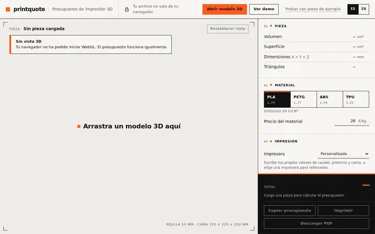</a>
      <h3>🧊 <a href="https://github.com/BertMarti/printquote">printquote</a></h3>
      
<strong>Del modelo 3D al presupuesto en segundos.</strong> Arrastra tu modelo 3D (STL, OBJ o 3MF), míralo y obtén peso, tiempo y precio sin subir el archivo a ningún servidor.

      
TypeScript · Three.js · Vite · PWA

      
      
    </td>
    <td width="33%" valign="top">
      <a href="https://bertmarti.github.io/commitling/">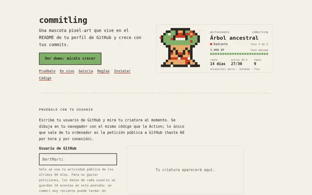</a>
      <h3>👾 <a href="https://github.com/BertMarti/commitling">commitling</a></h3>
      
<strong>Tu actividad convertida en una criatura digital.</strong> Una mascota pixel-art que vive en tu perfil de GitHub y crece con tus commits (la mía está aquí abajo).

      
Go · GitHub Actions · SVG animado · WebAssembly

      
      
    </td>
  </tr>
  <tr>
    <td width="33%" valign="top">
      <a href="https://github.com/BertMarti/vitaclip/releases/latest">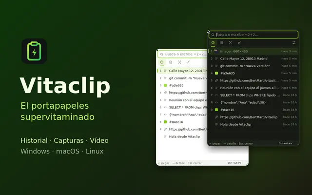</a>
      <h3>🍋 <a href="https://github.com/BertMarti/vitaclip">Vitaclip</a></h3>
      
<strong>El portapapeles supervitaminado.</strong> Historial de todo lo que copias (como Ditto), capturas con anotaciones (como Lightshot) y grabación de pantalla en MP4. App de escritorio gratis, sin cuentas y todo en tu equipo.

      
Tauri · Rust · JavaScript · Windows · macOS · Linux

      
      
    </td>
  </tr>
</table>

### 🎮 Juegos

<table>
  <tr>
    <td width="33%" valign="top">
      <a href="https://bertmarti.github.io/Roscodex/">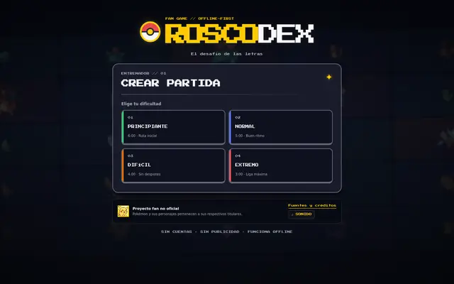</a>
      <h3>🧭 <a href="https://github.com/BertMarti/Roscodex">Roscodex</a></h3>
      
<strong>El rosco de las letras, versión Pokémon.</strong> Preguntas fan con estética pixel-art, contrarreloj y estadísticas: gratis, sin cuentas y también sin conexión.

      
React · TypeScript · Vite · PWA

      
      
    </td>
    <td width="33%" valign="top">
      <a href="https://bertmarti.github.io/Adivina-pkm/">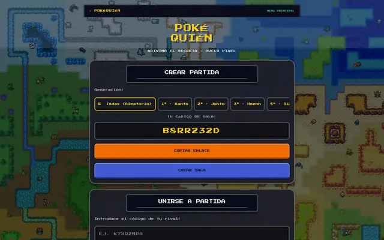</a>
      <h3>🎮 <a href="https://github.com/BertMarti/Adivina-pkm">PokéQuién</a></h3>
      
<strong>¿Quién es quién?, con Pokémon.</strong> Duelo de deducción pixel-art contra la máquina o contra un amigo, en el navegador; se instala en el móvil y el Solitario funciona sin conexión.

      
React Native (Expo) · TypeScript · WebSocket

      
      
    </td>
    <td width="33%" valign="top">
      <a href="https://bertmarti.github.io/squad-summoner-v3/">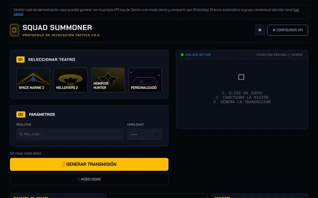</a>
      <h3>🎖️ <a href="https://github.com/BertMarti/squad-summoner-v3">Squad Summoner</a></h3>
      
<strong>Convocatorias épicas para tu escuadrón.</strong> Mensajes generados con IA para quedar a jugar a Helldivers 2, Space Marine 2, Monster Hunter y más, con el tono que elijas y encuesta de asistencia, listos para WhatsApp.

      
Vue 3 · TypeScript · Vite · Gemini

      
      
    </td>
  </tr>
</table>

<!-- tarjetas:fin -->

## 🤖 IA aplicada: de la idea al impacto

Estoy incorporando la **IA como una capa transversal** en mis proyectos: para explorar ideas, actualizar soluciones, mejorar la calidad del código, automatizar tareas repetitivas, generar mejores pruebas y tomar decisiones técnicas con más contexto.

En público estoy experimentando con [`modelduel`](https://github.com/BertMarti/modelduel), un benchmark que compara modelos con los mismos tests y mide aciertos, tiempo y coste, y con [`ARIA`](https://github.com/BertMarti/ARIA), un asistente que vive en casa y no depende de la nube. Me interesa convertir la IA en una herramienta práctica: más claridad al diseñar, más velocidad al construir y mejores productos al entregar.

## ⚡ Toolkit

| Frontend | Backend y datos | Entrega y herramientas |
|:---:|:---:|:---:|
|  |   |  |

## 🎯 En qué estoy trabajando ahora

- Diseñando mejores formas de integrar IA en el ciclo completo de desarrollo.
- Construyendo experiencias frontend con React, Angular y TypeScript.
- Diseñando APIs y procesos backend con Java, Spring Boot y Spring Batch.
- Mejorando automatizaciones, documentación, testing y pipelines de entrega.
- Aprendiendo, compartiendo y convirtiendo cada experimento en algo que pueda ser útil a otros.

## 🤝 Hablemos

¿Tienes una idea, un proyecto interesante o ganas de intercambiar aprendizajes sobre frontend, backend o IA? Puedes escribirme en [LinkedIn](https://www.linkedin.com/in/alberto-martinez-moreno/) o por [email](mailto:amarmor878@gmail.com).

<a href="https://bertmarti.github.io/commitling/">
  <picture>
    <source media="(prefers-color-scheme: dark)" srcset="./commitling-dark.svg">
    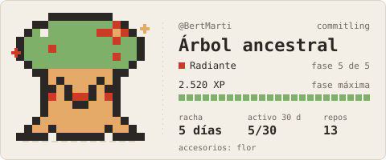
  </picture>
</a>

Mi <a href="https://github.com/BertMarti/commitling">commitling</a> crece con mis commits y se actualiza cada día.

### Gracias por pasarte por aquí ✨

